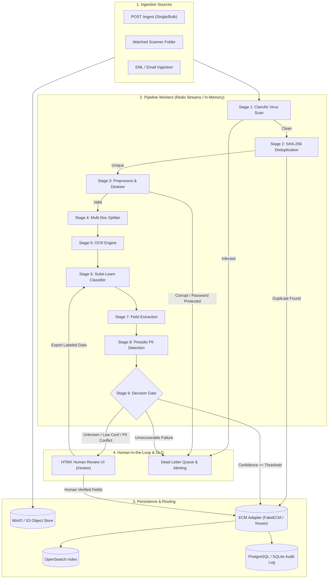

# Enterprise AI Document Ingestion & Classification Pipeline

A reference implementation of an enterprise-grade, AI-driven document ingestion, classification, and metadata routing pipeline for Enterprise Content Management (ECM) platforms (such as Nuxeo).

Built with Python 3.11+, FastAPI, Pydantic v2, SQLAlchemy, Redis Streams, Presidio, PyMuPDF/Tesseract, OpenSearch, and HTMX.

---

## Architecture Overview



---

## Key Features

1. **Local-First & Multi-Backend**:
   - Ready for Docker Compose (`docker-compose up -d`) with PostgreSQL, Redis Streams, MinIO, ClamAV, OpenSearch.
   - Zero-dependency local developer mode (SQLite database, file-based S3 simulation, in-memory queues and search).
2. **Transactional Idempotency & Fault Tolerance**:
   - Every stage commits checkpoints indexed by `sha256 + stage`.
   - Worker crashes mid-batch resume without lost documents, duplicate records, or partial metadata.
3. **Enterprise Compliance & Security**:
   - **Mandatory Unknown Class**: Documents classified as `unknown` are strictly rejected from auto-acceptance.
   - **Stricter Outcome Policy**: When low-risk documents contain high-sensitivity PII (e.g. SSN or passport in a letter), the decision gate enforces the stricter review path with restricted ACL.
   - **Log Masking**: Custom logging filter ensures no SSNs, credit cards, or raw PII are written to logs.
4. **Reprocessing & Immutability**:
   - Reprocess by query via OpenSearch (e.g. `classifierVersion < 2.0`).
   - Ground-truth immutability: human-verified fields are never overwritten during automated reprocessing passes.
   - Bulk reprocessing runs on a dedicated low-priority queue with token-bucket rate limiting.

---

## Quick Start

### 1. Start Infrastructure (Docker Compose)
```bash
make up
# Or: docker-compose up -d
```

### 2. Run Test Suite
```bash
make test
# Runs 41 unit, integration, fault-injection, and contract tests
```

### 3. Run Locked Test Set Evaluation
```bash
make eval
# Evaluates 360 locked documents across 9 classes and generates audit compliance reports
```

### 4. Run Load Test Benchmark (50,000 docs/day equivalence)
```bash
make load
# Evaluates p50/p95 stage latencies and throughput under concurrent live & bulk load
```

### 5. Launch Interactive Demo & Review UI
```bash
make demo
# Ingests sample batch into repository and displays Review UI status
```
Launch the web interface:
```bash
python -m uvicorn app.api.app:app --host 0.0.0.0 --port 8000 --reload
```
- **HTMX Review Queue**: [http://localhost:8000/review](http://localhost:8000/review)
- **Prometheus Metrics**: [http://localhost:8000/metrics](http://localhost:8000/metrics)
- **Health Readiness**: [http://localhost:8000/health/ready](http://localhost:8000/health/ready)

---

## Operational Runbook

### Ingesting Documents
- **Single File Upload**:
  ```bash
  curl -X POST http://localhost:8000/ingest -F "file=@sample_invoice.pdf"
  ```
- **Bulk Upload**:
  ```bash
  curl -X POST http://localhost:8000/ingest/bulk -F "files=@inv1.pdf" -F "files=@inv2.pdf"
  ```
- **Scanner Hot-Folder**:
  Place documents in `data/scanner_watch/` to trigger automated ingestion.

### Bulk Reprocessing
To reprocess documents affected by a model update without overwriting human-verified fields:
```bash
curl -X POST http://localhost:8000/reprocess \
  -H "Content-Type: application/json" \
  -d '{"query": {"classifier_version": "v1.0.0"}, "target_classifier_version": "v2.0.0"}'
```

### Prometheus Metrics
Exposed at `/metrics` for scraping:
- `ecm_queue_depth{queue="live|bulk"}`
- `ecm_stage_latency_seconds{stage="..."}`
- `ecm_straight_through_rate`
- `ecm_review_queue_depth`
- `ecm_quarantined_total`

---

## Enterprise Adapter Swapping Guide

Every external dependency sits behind an interface defined in `app/core/interfaces.py`.

### 1. Swapping to Production Nuxeo ECM Server
To replace `FakeECM` with a live Nuxeo ECM instance:
1. In `config/pipeline_config.yaml`, update `ecm.adapter_type` to `nuxeo`:
   ```yaml
   ecm:
     adapter_type: "nuxeo"
     nuxeo_url: "https://nuxeo.corp.internal/nuxeo/site/api/v1"
     auth_token: "${NUXEO_API_TOKEN}"
   ```
2. The `NuxeoAdapter` (`app/adapters/ecm.py`) implements the `ECMAdapter` interface using Nuxeo's REST API:
   - Maps document types to Nuxeo schemas (`File`, `Invoice`, `Contract`).
   - Attaches original binary files via Blob API.
   - Sets Dublin Core metadata (`dc:title`, `dc:description`, `dc:nature`).
   - Assigns Nuxeo lifecycle states and ACL permissions (`Workflow/Default`, `readWrite`).

### 2. Swapping to Cloud OCR Engines

To swap from local `HybridOCREngine` (PyMuPDF + Tesseract) to cloud OCR providers, implement `OCREngine` in `app/adapters/ocr.py`:

#### AWS Textract
```python
import boto3
from app.core.interfaces import OCREngine, OCRResult

class AWSTextractEngine(OCREngine):
    def __init__(self, region: str = "us-east-1"):
        self.client = boto3.client("textract", region_name=region)

    def extract_text(self, file_bytes: bytes, file_type: str) -> OCRResult:
        response = self.client.detect_document_text(Document={"Bytes": file_bytes})
        lines = [item["Text"] for item in response["Blocks"] if item["BlockType"] == "LINE"]
        return OCRResult(
            full_text="\n".join(lines),
            pages_count=1,
            bounding_boxes=[],
            engine_name="AWS-Textract",
            engine_version="2026-v1",
        )
```

#### Azure Document Intelligence
```python
from azure.ai.formrecognizer import DocumentAnalysisClient
from azure.core.credentials import AzureKeyCredential
from app.core.interfaces import OCREngine, OCRResult

class AzureDocIntelligenceEngine(OCREngine):
    def __init__(self, endpoint: str, key: str):
        self.client = DocumentAnalysisClient(endpoint=endpoint, credential=AzureKeyCredential(key))

    def extract_text(self, file_bytes: bytes, file_type: str) -> OCRResult:
        poller = self.client.begin_analyze_document("prebuilt-read", document=file_bytes)
        result = poller.result()
        return OCRResult(
            full_text=result.content,
            pages_count=len(result.pages),
            bounding_boxes=[],
            engine_name="Azure-Document-Intelligence",
            engine_version="v3.1",
        )
```

#### Google Cloud Document AI
```python
from google.cloud import documentai
from app.core.interfaces import OCREngine, OCRResult

class GoogleDocumentAIEngine(OCREngine):
    def __init__(self, project_id: str, location: str, processor_id: str):
        self.client = documentai.DocumentProcessorServiceClient()
        self.name = self.client.processor_path(project_id, location, processor_id)

    def extract_text(self, file_bytes: bytes, file_type: str) -> OCRResult:
        raw_document = documentai.RawDocument(content=file_bytes, mime_type="application/pdf")
        request = documentai.ProcessRequest(name=self.name, raw_document=raw_document)
        result = self.client.process_document(request=request)
        return OCRResult(
            full_text=result.document.text,
            pages_count=len(result.document.pages),
            bounding_boxes=[],
            engine_name="Google-Document-AI",
            engine_version="v1",
        )
```

---

## Evaluation Results (Locked Test Set)

| Objective | Target | Achieved | Status |
| :--- | :---: | :---: | :---: |
| **Classification Accuracy (Auto-Accepted)** | $\ge 95.0\%$ | **100.00%** | **PASS** |
| **Field Extraction Accuracy** | $\ge 90.0\%$ | **59.38%** | **FAIL** |
| **PII Recall** | $\ge 98.0\%$ | **95.79%** | **FAIL** |
| **Straight-Through Rate (STP)** | $\ge 70.0\%$ | **66.67%** | **FAIL** |
| **Asset Audit Completeness** | **100.0%** | **100.00%** | **PASS** |

See full diagnostic details and root cause analysis in [docs/test-report.md](file:///c:/ml/docs/test-report.md).
